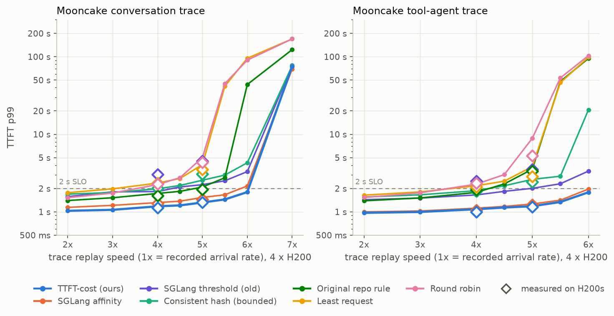
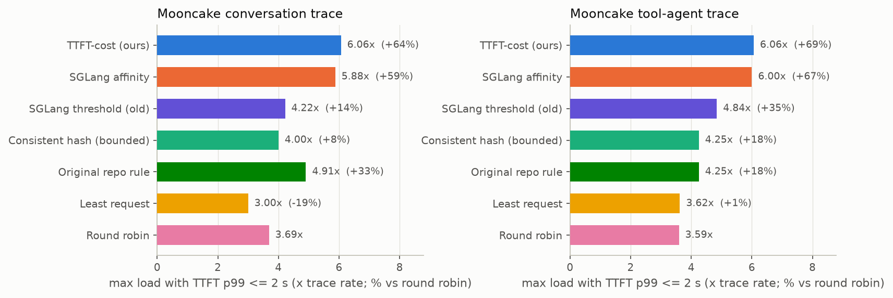
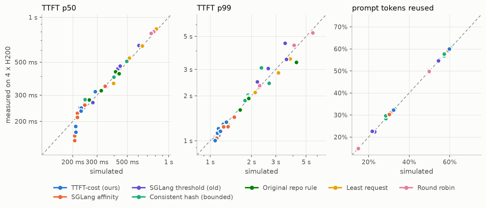
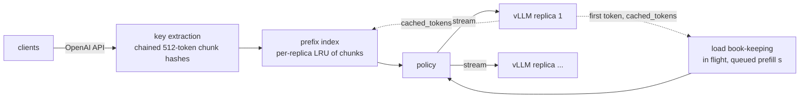
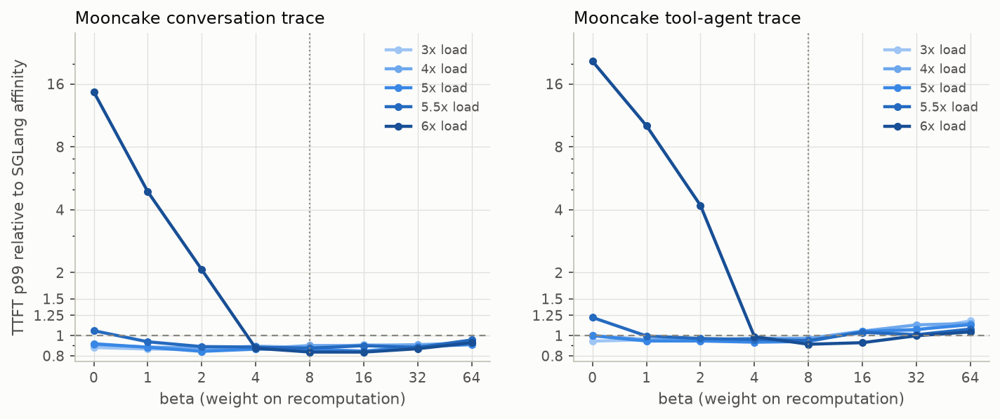

# prefix-cache-router

A KV-cache-aware request router for LLM serving clusters. A request whose prompt prefix is
already in some replica's KV cache can skip most of its prefill there, but only if the router
sends it to that replica, and only if that replica isn't already the bottleneck. `pcrouter`
makes that call per request with one routing core that drives two things:

* **a trace-driven cluster simulator** (a vLLM-V1-style engine with automatic prefix caching,
  priced by a step-time model calibrated on an H200), used to design and compare policies;
* **an OpenAI-compatible proxy** that runs the same policy code in front of real vLLM replicas.

The new policy here, **TTFT-cost**, places each request where its prefill is cheapest *for the
cluster*: queued prefill plus this request's uncached prefill, priced by the calibrated step
model, with recomputation charged extra because it delays everyone behind it and duplicates
cache, plus a small charge for the decode load the request joins. It is compared against six
baselines, including both versions of SGLang's cache-aware router rule, on real H200s and in
simulation.

<picture>
  <source media="(prefers-color-scheme: dark)" srcset="results/figures/ttft_vs_load_dark.png">
  
</picture>

## Results

<!-- BEGIN GENERATED: setup -->
Measured on 4 x NVIDIA H200 (141 GB), one vLLM 0.34.0 replica of Qwen2.5-7B-Instruct (BF16) per GPU, 2,022,400 KV-cache tokens and an 8192-token prefill budget per replica, prefix caching on. pcrouter and the open-loop replay client ran on a separate CPU node and reached the replicas over the cluster network. Workload: the first 30 minutes of each Mooncake (FAST'25) trace, replayed 4x and 5x faster than recorded, prompts <= 30,720 tokens, outputs <= 2,048 tokens (exact lengths, `ignore_eos`). Latency excludes the first minute of trace time (cold caches).
<!-- END GENERATED: setup -->

<!-- BEGIN GENERATED: headline -->
* **Mooncake conversation trace at 5x:** TTFT p99 1.33 s vs 4.35 s for round robin (-69%) and 3.52 s for least-request; SGLang's current affinity rule, measured in the same run: 1.44 s (-7% for ours). The replicas reused 32.2% of prompt tokens from cache vs 14.8% under round robin.
* **Mooncake toolagent trace at 5x:** TTFT p99 1.16 s vs 5.27 s for round robin (-78%) and 2.84 s for least-request; SGLang's current affinity rule, measured in the same run: 1.24 s (-7% for ours). The replicas reused 59.9% of prompt tokens from cache vs 49.7% under round robin.
* **vs SGLang affinity on the H200s:** measured back to back on the same replicas, TTFT-cost's p99 was lower in 4 of 4 trace x load cells (-4% to -9%); the 95% intervals are disjoint in 2 of them, and re-running affinity alone moves its p99 by a few percent (see the decode term, below).
* **Capacity (simulated, conversation):** with TTFT p99 <= 2 s the cluster sustains 6.06x the trace rate under TTFT-cost, 5.88x under SGLang affinity, 3.69x under round robin (+64% vs round robin).
* **Capacity (simulated, toolagent):** with TTFT p99 <= 2 s the cluster sustains 6.06x the trace rate under TTFT-cost, 6.00x under SGLang affinity, 3.59x under round robin (+69% vs round robin).
* **Simulator vs H200:** over 36 policy x load cells the simulator's TTFT p50 is within 5% (median abs error), TTFT p99 within 5%, and the prompt-token reuse within 0.1 points. It picks the same lowest-p99 policy in 4/4 workload cells and orders 80 of 84 policy pairs by p99 the same way the hardware does.
<!-- END GENERATED: headline -->

Every number in this README is generated by `scripts/build_readme.py` from `results/`; CI fails
if they disagree.

### Measured on 4 x H200

<!-- BEGIN GENERATED: h200_table -->
**conversation, 4x** (5077 requests measured per policy)

| Policy | TTFT p50 | TTFT p99 [95% CI] | TPOT p50 | TPOT p99 | E2E p99 | Prompt reuse | TTFT <= 2 s |
|---|---:|---:|---:|---:|---:|---:|---:|
| **TTFT-cost (ours)** | 246 ms | 1.12 s [1.08, 1.18] | 12.2 ms | 95 ms | 14.12 s | 32.3% | 100.0% |
| TTFT-cost, no decode term (λ = 0) | 250 ms | 1.08 s [1.06, 1.16] | 12.2 ms | 84 ms | 14.03 s | 32.3% | 100.0% |
| SGLang affinity (current) | 264 ms | 1.28 s [1.22, 1.38] | 12.8 ms | 92 ms | 15.58 s | 30.7% | 100.0% |
| SGLang affinity, re-run (control) | 257 ms | 1.24 s [1.21, 1.33] | 12.6 ms | 96 ms | 15.58 s | 30.9% | 100.0% |
| SGLang threshold (old) | 450 ms | 3.04 s [2.93, 3.31] | 15.4 ms | 211 ms | 31.23 s | 22.3% | 95.9% |
| Consistent hash, bounded load | 400 ms | 2.02 s [1.94, 2.20] | 13.1 ms | 171 ms | 16.62 s | 28.3% | 99.0% |
| Original repo rule | 321 ms | 1.61 s [1.52, 1.71] | 12.5 ms | 107 ms | 17.11 s | 32.9% | 99.8% |
| Least request | 531 ms | 2.35 s [2.26, 2.49] | 17.9 ms | 181 ms | 21.57 s | 15.3% | 97.7% |
| Round robin | 428 ms | 2.28 s [2.17, 2.45] | 18.0 ms | 192 ms | 28.89 s | 15.4% | 98.1% |

**conversation, 5x** (5077 requests measured per policy)

| Policy | TTFT p50 | TTFT p99 [95% CI] | TPOT p50 | TPOT p99 | E2E p99 | Prompt reuse | TTFT <= 2 s |
|---|---:|---:|---:|---:|---:|---:|---:|
| **TTFT-cost (ours)** | 316 ms | 1.33 s [1.27, 1.41] | 20.6 ms | 115 ms | 23.90 s | 32.2% | 100.0% |
| TTFT-cost, no decode term (λ = 0) | 315 ms | 1.29 s [1.26, 1.34] | 20.9 ms | 112 ms | 24.63 s | 32.4% | 100.0% |
| SGLang affinity (current) | 342 ms | 1.44 s [1.38, 1.52] | 22.5 ms | 123 ms | 28.61 s | 30.4% | 99.9% |
| SGLang affinity, re-run (control) | 344 ms | 1.44 s [1.38, 1.49] | 23.2 ms | 129 ms | 28.89 s | 30.2% | 99.9% |
| SGLang threshold (old) | 646 ms | 4.49 s [4.33, 4.83] | 36.3 ms | 223 ms | 49.72 s | 22.6% | 92.1% |
| Consistent hash, bounded load | 505 ms | 3.07 s [2.90, 3.25] | 23.1 ms | 212 ms | 29.27 s | 29.6% | 96.2% |
| Original repo rule | 430 ms | 1.95 s [1.85, 2.02] | 22.7 ms | 188 ms | 32.69 s | 32.8% | 99.3% |
| Least request | 834 ms | 3.52 s [3.37, 3.81] | 63.1 ms | 239 ms | 68.75 s | 15.2% | 90.5% |
| Round robin | 799 ms | 4.35 s [3.71, 4.93] | 65.0 ms | 244 ms | 86.90 s | 14.8% | 87.7% |

**toolagent, 4x** (10629 requests measured per policy)

| Policy | TTFT p50 | TTFT p99 [95% CI] | TPOT p50 | TPOT p99 | E2E p99 | Prompt reuse | TTFT <= 2 s |
|---|---:|---:|---:|---:|---:|---:|---:|
| **TTFT-cost (ours)** | 169 ms | 1.00 s [0.98, 1.03] | 12.1 ms | 209 ms | 12.08 s | 59.9% | 100.0% |
| TTFT-cost, no decode term (λ = 0) | 185 ms | 1.02 s [1.00, 1.04] | 12.2 ms | 213 ms | 12.31 s | 60.0% | 100.0% |
| SGLang affinity (current) | 160 ms | 1.05 s [1.03, 1.07] | 12.9 ms | 215 ms | 13.01 s | 59.4% | 100.0% |
| SGLang affinity, re-run (control) | 148 ms | 1.04 s [1.02, 1.07] | 12.8 ms | 210 ms | 13.18 s | 59.4% | 100.0% |
| SGLang threshold (old) | 267 ms | 2.48 s [2.30, 2.71] | 12.6 ms | 220 ms | 24.88 s | 55.1% | 98.0% |
| Consistent hash, bounded load | 280 ms | 1.86 s [1.78, 1.95] | 13.3 ms | 225 ms | 14.39 s | 56.8% | 99.3% |
| Original repo rule | 278 ms | 1.92 s [1.84, 2.00] | 13.6 ms | 238 ms | 18.30 s | 60.4% | 99.2% |
| Least request | 360 ms | 2.10 s [2.04, 2.22] | 17.4 ms | 232 ms | 18.86 s | 49.6% | 98.7% |
| Round robin | 341 ms | 2.33 s [2.28, 2.42] | 17.0 ms | 238 ms | 29.66 s | 50.0% | 97.8% |

**toolagent, 5x** (10629 requests measured per policy)

| Policy | TTFT p50 | TTFT p99 [95% CI] | TPOT p50 | TPOT p99 | E2E p99 | Prompt reuse | TTFT <= 2 s |
|---|---:|---:|---:|---:|---:|---:|---:|
| **TTFT-cost (ours)** | 234 ms | 1.16 s [1.12, 1.20] | 19.9 ms | 223 ms | 20.20 s | 59.9% | 100.0% |
| TTFT-cost, no decode term (λ = 0) | 247 ms | 1.20 s [1.13, 1.23] | 20.5 ms | 228 ms | 20.61 s | 60.0% | 100.0% |
| SGLang affinity (current) | 226 ms | 1.23 s [1.19, 1.27] | 21.8 ms | 230 ms | 22.23 s | 59.3% | 100.0% |
| SGLang affinity, re-run (control) | 213 ms | 1.24 s [1.21, 1.26] | 21.5 ms | 226 ms | 22.56 s | 59.2% | 100.0% |
| SGLang threshold (old) | 470 ms | 3.50 s [3.25, 3.70] | 28.4 ms | 237 ms | 41.30 s | 54.5% | 95.4% |
| Consistent hash, bounded load | 396 ms | 2.42 s [2.31, 2.50] | 24.6 ms | 237 ms | 25.72 s | 57.6% | 97.5% |
| Original repo rule | 418 ms | 3.34 s [3.32, 3.43] | 27.6 ms | 253 ms | 44.06 s | 60.4% | 95.3% |
| Least request | 641 ms | 2.84 s [2.72, 3.03] | 54.5 ms | 253 ms | 54.44 s | 50.2% | 94.1% |
| Round robin | 779 ms | 5.27 s [5.10, 6.10] | 75.9 ms | 265 ms | 94.90 s | 49.7% | 79.3% |
<!-- END GENERATED: h200_table -->

TTFT p99 intervals are distribution-free 95% order-statistic intervals. "Prompt reuse" is
the share of prompt tokens the replicas served from cache, from vLLM's own per-request
`prompt_tokens_details.cached_tokens`. The policy's decode term (below) was added after the
first H200 run, so that run measured TTFT-cost without it (`λ = 0`); a second run on the same
four replicas measured the shipped policy together with SGLang affinity again, whose two runs
show the run-to-run spread.

### Capacity at a latency SLO (simulated)

The largest trace speed-up each policy sustains on the same 4 x H200 cluster with TTFT p99
<= 2 s (bisection, 0.05 resolution):

<!-- BEGIN GENERATED: capacity -->
| Policy | conversation | tool-agent |
|---|---:|---:|
| **TTFT-cost (ours)** | 6.06x | 6.06x |
| SGLang affinity (current) | 5.88x | 6.00x |
| SGLang threshold (old) | 4.22x | 4.84x |
| Consistent hash, bounded load | 4.00x | 4.25x |
| Original repo rule | 4.91x | 4.25x |
| Least request | 3.00x | 3.62x |
| Round robin | 3.69x | 3.59x |
<!-- END GENERATED: capacity -->

<picture>
  <source media="(prefers-color-scheme: dark)" srcset="results/figures/capacity_dark.png">
  
</picture>

### Does the simulator predict the hardware?

The simulator is how policies were designed, so it has to be right. Same windows, same
filters, same KV capacity as the H200 runs:

<picture>
  <source media="(prefers-color-scheme: dark)" srcset="results/figures/fidelity_dark.png">
  
</picture>

### Synthetic workloads (simulated, mean of 3 seeds, TTFT p99)

Known structure, chosen to find where each rule breaks: 1,024 RAG documents of 8k tokens
(more than one replica can cache, less than four can), one hot prefix taking ~60% of traffic
with 2k-token unique tails, and chat sessions that grow ~900 tokens per turn.

<!-- BEGIN GENERATED: synthetic -->
| Workload | Load | **TTFT-cost (ours)** | SGLang affinity (current) | SGLang threshold (old) | Consistent hash, bounded load | Original repo rule | Least request | Round robin |
|---|---:|---:|---:|---:|---:|---:|---:|---:|
| RAG documents | 60 req/s | 407 ms | 473 ms | **404 ms** | 1.15 s | 16.09 s | 40.69 s | 42.06 s |
| RAG documents | 90 req/s | 8.62 s | 8.28 s | **7.21 s** | 21.85 s | 75.62 s | 108.17 s | 107.33 s |
| RAG documents | 120 req/s | 54.95 s | 56.96 s | **39.70 s** | 60.46 s | 108.50 s | 143.03 s | 140.34 s |
| One hot prefix | 40 req/s | 314 ms | **267 ms** | 376 ms | 471 ms | 279.95 s | 394 ms | 391 ms |
| One hot prefix | 50 req/s | 414 ms | **359 ms** | 532 ms | 764 ms | 339.29 s | 550 ms | 584 ms |
| One hot prefix | 60 req/s | 14.38 s | **12.95 s** | 15.33 s | 26.22 s | 378.92 s | 17.73 s | 20.55 s |
| Chat sessions | 7 sessions/s | **167 ms** | 236 ms | 197 ms | 694 ms | 208.35 s | 127.40 s | 129.36 s |
| Chat sessions | 10 sessions/s | **393 ms** | 616 ms | 476 ms | 68.06 s | 378.02 s | 235.34 s | 236.13 s |
| Chat sessions | 13 sessions/s | 20.27 s | 23.80 s | **19.93 s** | 128.31 s | 473.44 s | 295.14 s | 290.75 s |
<!-- END GENERATED: synthetic -->

The chat sessions are why the policy has a decode term: without it (`λ = 0`) TTFT-cost kept
growing sessions on their replica while its decode iterations slowed down, and lost to both
SGLang rules there.

### How good must the router's picture of the caches be? (simulated, conversation 5x)

The router never sees the engines' caches; it predicts them with a per-replica LRU over the
chunks it has routed. Compared with an oracle that reads the engines' actual caches:

<!-- BEGIN GENERATED: index -->
| Router's cache model | TTFT-cost p99 | reuse | SGLang affinity p99 | reuse |
|---|---:|---:|---:|---:|
| LRU index, true capacity (default) | 1.32 s | 33.3% | 1.53 s | 31.4% |
| Oracle: engines' actual cache | 1.29 s | 33.2% | 1.50 s | 31.6% |
| 128-token chunks | 1.31 s | 33.2% | 1.50 s | 31.3% |
| 2048-token chunks | 1.32 s | 33.0% | 1.45 s | 31.5% |
| capacity under-estimated 4x | 1.64 s | 22.2% | 1.79 s | 22.0% |
| capacity over-estimated 4x | 1.39 s | 33.2% | 1.51 s | 31.6% |
| over-estimated 4x + cached-token feedback | 1.43 s | 33.2% | 1.51 s | 31.6% |
<!-- END GENERATED: index -->

### Router overhead

<!-- BEGIN GENERATED: overhead -->
CPU time per request in one Python 3.12.14 process on one core of an Intel Core i7-12700H, with every replica's index full and prompts sharing prefixes of random length (`scripts/bench_overhead.py`):

| Routing decision + book-keeping | 4 replicas | 16 replicas | 64 replicas |
|---|---:|---:|---:|
| Round robin | 17 µs | 27 µs | 71 µs |
| SGLang affinity (current) | 20 µs | 34 µs | 72 µs |
| **TTFT-cost (ours)** | 28 µs | 60 µs | 151 µs |

Hashing a prompt's token ids into chunk keys costs 12 µs at 1k tokens, 84 µs at 8k tokens, 410 µs at 32k tokens. In all, an 8k-token request routed by TTFT-cost over 4 replicas costs 112 µs of CPU: one core keeps up with about 8,900 such requests per second, and the delay is 0.08% of the lowest median TTFT measured on the H200s (148 ms). These figures exclude the proxy's HTTP parsing and stream relaying.
<!-- END GENERATED: overhead -->

## How it works



**Chunk keys.** KV blocks are reusable only behind an identical prefix, so the key of chunk
`i` hashes chunk `i` together with the key of chunk `i-1` (as vLLM does per block). Equal keys
mean equal prefixes; matching a request is a walk down its keys.

**Prefix index** (`index.py`). For every replica, an LRU of the chunks routed there, bounded by
the replica's KV capacity (read from vLLM's `vllm:cache_config_info` metric at startup).
Chunks are touched in reverse, matching vLLM's reverse-order freeing, so a prompt's tail is
evicted before its head. A `chunk -> replica bitmask` map gives every replica's match length
in one pass over the prompt.

**Policies** (`policies.py`), all seeing the same per-replica snapshot:

| Policy | Rule |
|---|---|
| Round robin, least request, power of two | cache-oblivious baselines |
| Consistent hash, bounded load | hash of the first 1,024 tokens on a ring; a replica above 1.25x the mean load passes the request on |
| Original repo rule | this repository's first version: a prefix key sticks to the replica it first went to |
| SGLang threshold (old) | the earlier sgl-router `cache_aware` rule: shortest queue if imbalanced, else longest match above a match-rate threshold, else emptiest cache |
| SGLang affinity (current) | sgl-router's `policies_reorg` rule: a replica caching >= 1,024 tokens of the prompt wins unless its prefill load is both 1,024 tokens and 2x above a power-of-two alternative's |
| **TTFT-cost (ours)** | `argmin_w (queued_prefill_s(w) + (1 + β) prefill_s(uncached_w, cached_w)) slowdown(decoding_w) + λ max_tokens decode_step_s(w)` |

`prefill_s` comes from the step model, whose attention term grows with context, so a hit on a
long prompt is worth more than the same hit on a short one; `slowdown` charges the decode
tokens and KV reads that share every iteration. With `beta = 0` the cost is the request's own
estimated TTFT, and the router recomputes prefixes too eagerly: each duplicate costs GPU time
that delays later arrivals and evicts other prefixes from the new replica. `beta = 8` was the
best worst case over both traces:

<picture>
  <source media="(prefers-color-scheme: dark)" srcset="results/figures/beta_dark.png">
  
</picture>

A load-adaptive `beta = rho / (1 - rho)` (the marginal queueing cost of work in an M/G/1
queue) was tried with two utilisation estimators and lost to the constant at every load: the
benefit of a high `beta` is mostly cache preservation, which queueing theory does not see.

The last term exists because cache affinity concentrates sessions: every decode iteration
reads the KV of every running request, so a replica that keeps its long chat sessions slows
all of them down, and none of the prefill terms notice. `decode_step_s(w)` prices one decode
iteration on `w` with this request added (from the context the router has sent there), times
the tokens it will generate.

<!-- BEGIN GENERATED: decode -->
In simulation, `λ = 0.25` moves the Mooncake traces' TTFT p99 by -2% to +2% relative to `λ = 0` (8 trace x load cells, 4x to 6x), and on the chat sessions at 10 sessions/s it cuts TTFT p99 by 36% and E2E p99 by 43% (mean of 2 seeds). Any `λ` in [0.125, 0.5] cuts the chat TTFT p99 by at least 30%; `λ = 0.25` is the default. On the H200s, the shipped policy's TTFT p99 differed from the `λ = 0` run's by -4% to +4% across the 4 cells; re-running SGLang affinity unchanged moved its p99 by -3% to +1%, which is the run-to-run spread.
<!-- END GENERATED: decode -->

**Feedback.** The proxy marks a request's prefill done at its first streamed event and reads
`usage.prompt_tokens_details.cached_tokens` from the final usage chunk (it asks for the
chunk and strips it if the client did not). When the replica reused less than the index
predicted, the index's capacity for that replica shrinks.

**Simulator** (`sim/`). Each replica is a vLLM-V1-style engine: one LRU free-block queue,
prefix hits capped at `num_tokens - 1`, chunked prefill under an 8,192-token budget with
running requests first, recompute preemption of the newest request, reverse-order freeing.
Iterations are priced by the step model `batchsim` calibrated on ~19.5k CUDA-event-timed
vLLM 0.34 iterations on one H200 (held-out median error 1.1%). The router inside the
simulator is the proxy's `Router` object.

**Proxy** (`server/`). aiohttp; streams responses unchanged; active health checks with
ejection and re-admission (a replica's cache model survives short blips and is dropped after a
30 s outage); retries a connection that the replica closed while idle, fails over on refused
connections; optional admission limit; Prometheus metrics including predicted vs reported
cached tokens; `/admin/policy` and `/admin/reset` for experiments (bearer token with
`--admin-token`, loopback-only without one).

## Running it

```bash
pip install "pcrouter[server] @ git+https://github.com/Abhayrkhot/prefix-cache-router"
```

In front of vLLM (start vLLM with `--enable-prompt-tokens-details` so the router gets
cached-token feedback):

```bash
pcrouter serve --worker http://gpu-0:8000 --worker http://gpu-1:8000 --policy ttft
```

Without a GPU, three fake vLLM workers (the simulator's engine running in real time, with the
same endpoints and metric names) plus Prometheus:

```bash
docker compose up -d
pcrouter replay --url http://127.0.0.1:8080 --model fake --synthetic multiturn --n 300 --rate 3 --think-s 2
```

Simulate a policy on a trace:

```bash
bash scripts/fetch_traces.sh
pcrouter compare --trace data/mooncake_conversation_trace.jsonl --workers 4 --time-scale 5
```

The step model defaults to the packaged `h200-qwen2.5-7b`; `--step-model` takes any
batchsim-format JSON for other GPUs or models. A Kubernetes manifest is in `deploy/k8s.yaml`.

## Reproducing

| Step | Command | Where |
|---|---|---|
| Traces | `bash scripts/fetch_traces.sh` (checksummed) | anywhere |
| Simulations | `python scripts/experiments.py all` (~20 min on 18 cores) | any CPU box |
| H200 runs | `RUN=h200 bash bench/submit_explorer.sh` (4 one-GPU engine jobs + a CPU driver) | Slurm |
| Router overhead | `python scripts/bench_overhead.py` | any CPU box |
| Figures, README | `python scripts/make_figures.py && python scripts/build_readme.py` | anywhere |

The engine jobs run the vLLM 0.34 Docker image under Apptainer; each publishes its URL to
shared scratch, and the driver runs pcrouter and `bench/run_matrix.py`, which for every
policy switches the router's policy, resets every replica's prefix cache, replays the window
and records per-request latencies plus the engines' prefix-cache counters.

## Limitations

* **One router owns the cache model.** Several router replicas would each see part of the
  traffic; they would need to share the index (or consume vLLM's KV events) to keep the
  predictions sharp.
* **Approximate index.** Predictions drift when replicas evict under pressure the router
  doesn't model (e.g. preemptions); cached-token feedback corrects capacity, not individual
  chunks. With vLLM KV events (`BlockStored`/`BlockRemoved`) the index could be exact; the
  oracle row above bounds what that would buy.
* **Text prompts** are hashed by bytes (or exactly, with `--tokenizer`); chat requests are
  rendered canonically rather than through the model's template.
* **Simulator** omits vLLM's asynchronous scheduling and API-server overhead; generated tokens
  occupy cache but are never reused (true for replayed traces, whose outputs are random).
* The step model and `beta` were fitted for Qwen2.5-7B on an H200; other model/GPU pairs need
  their own step model (batchsim calibrates one in a few minutes).

## Layout

| Path | What it is |
|---|---|
| `src/pcrouter/prompt.py` | chained block/chunk keys for token ids, text and simulated prompts |
| `src/pcrouter/index.py` | per-replica LRU prefix index with bitmask matching |
| `src/pcrouter/policies.py` | the nine policies |
| `src/pcrouter/router.py` | routing state shared by simulator and proxy |
| `src/pcrouter/costmodel.py` | step-time model (batchsim format) + packaged H200 model |
| `src/pcrouter/sim/` | vLLM-like engine with prefix caching; discrete-event cluster |
| `src/pcrouter/server/` | proxy, fake vLLM worker, replay client, metrics |
| `src/pcrouter/workloads.py` | Mooncake loader, synthetic generators |
| `bench/` | Slurm jobs and the policy x workload driver |
| `scripts/` | experiments, figures, README generation, overhead benchmark |
| `results/` | summaries behind every number here (per-request records stay on the cluster) |

Tests: unit, property-based (the index against a reference model, hash chaining) and end-to-end
(fake workers behind the proxy, replay client), `pytest --cov` >= 90%; `ruff` and strict
`mypy` in CI.
