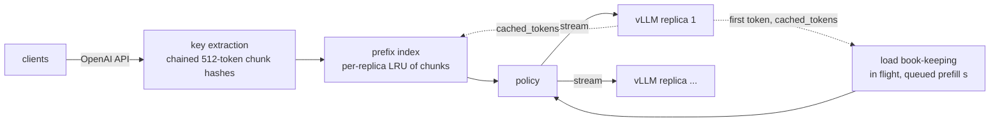

# prefix-cache-router

A KV-cache-aware request router for LLM serving clusters. A request whose prompt prefix is
already in some replica's KV cache can skip most of its prefill there, but only if the router
sends it to that replica, and only if that replica isn't already the bottleneck. `pcrouter`
makes that call per request with one routing core that drives two things:

* **a trace-driven cluster simulator** (a vLLM-V1-style engine with automatic prefix caching,
  priced by a step-time model calibrated on an H200), used to design and compare policies;
* **an OpenAI-compatible proxy** that runs the same policy code in front of real vLLM replicas.

The new policy here, **TTFT-cost**, places each request where its prefill is cheapest *for the
cluster*: queued prefill plus this request's uncached prefill, priced by the calibrated step
model, with recomputation charged extra because it delays everyone behind it and duplicates
cache, plus a small charge for the decode load the request joins. It is compared against six
baselines, including both versions of SGLang's cache-aware router rule, on real H200s and in
simulation.

<picture>
  <source media="(prefers-color-scheme: dark)" srcset="results/figures/ttft_vs_load_dark.png">
  
</picture>

## Results

<!-- BEGIN GENERATED: setup -->
<!-- END GENERATED: setup -->

<!-- BEGIN GENERATED: headline -->
<!-- END GENERATED: headline -->

Every number in this README is generated by `scripts/build_readme.py` from `results/`; CI fails
if they disagree.

### Measured on 4 x H200

<!-- BEGIN GENERATED: h200_table -->
<!-- END GENERATED: h200_table -->

TTFT p99 intervals are distribution-free 95% order-statistic intervals. "Prompt reuse" is
the share of prompt tokens the replicas served from cache, from vLLM's own per-request
`prompt_tokens_details.cached_tokens`. The policy's decode term (below) was added after the
first H200 run, so that run measured TTFT-cost without it (`λ = 0`); a second run on the same
four replicas measured the shipped policy together with SGLang affinity again, whose two runs
show the run-to-run spread.

### Capacity at a latency SLO (simulated)

The largest trace speed-up each policy sustains on the same 4 x H200 cluster with TTFT p99
<= 2 s (bisection, 0.05 resolution):

<!-- BEGIN GENERATED: capacity -->
<!-- END GENERATED: capacity -->

<picture>
  <source media="(prefers-color-scheme: dark)" srcset="results/figures/capacity_dark.png">
  
</picture>

### Does the simulator predict the hardware?

The simulator is how policies were designed, so it has to be right. Same windows, same
filters, same KV capacity as the H200 runs:

<picture>
  <source media="(prefers-color-scheme: dark)" srcset="results/figures/fidelity_dark.png">
  
</picture>

### Synthetic workloads (simulated, mean of 3 seeds, TTFT p99)

Known structure, chosen to find where each rule breaks: 1,024 RAG documents of 8k tokens
(more than one replica can cache, less than four can), one hot prefix taking ~60% of traffic
with 2k-token unique tails, and chat sessions that grow ~900 tokens per turn.

<!-- BEGIN GENERATED: synthetic -->
<!-- END GENERATED: synthetic -->

The chat sessions are why the policy has a decode term: without it (`λ = 0`) TTFT-cost kept
growing sessions on their replica while its decode iterations slowed down, and lost to both
SGLang rules there.

### How good must the router's picture of the caches be? (simulated, conversation 5x)

The router never sees the engines' caches; it predicts them with a per-replica LRU over the
chunks it has routed. Compared with an oracle that reads the engines' actual caches:

<!-- BEGIN GENERATED: index -->
<!-- END GENERATED: index -->

### Router overhead

<!-- BEGIN GENERATED: overhead -->
<!-- END GENERATED: overhead -->

## How it works



**Chunk keys.** KV blocks are reusable only behind an identical prefix, so the key of chunk
`i` hashes chunk `i` together with the key of chunk `i-1` (as vLLM does per block). Equal keys
mean equal prefixes; matching a request is a walk down its keys.

**Prefix index** (`index.py`). For every replica, an LRU of the chunks routed there, bounded by
the replica's KV capacity (read from vLLM's `vllm:cache_config_info` metric at startup).
Chunks are touched in reverse, matching vLLM's reverse-order freeing, so a prompt's tail is
evicted before its head. A `chunk -> replica bitmask` map gives every replica's match length
in one pass over the prompt.

**Policies** (`policies.py`), all seeing the same per-replica snapshot:

| Policy | Rule |
|---|---|
| Round robin, least request, power of two | cache-oblivious baselines |
| Consistent hash, bounded load | hash of the first 1,024 tokens on a ring; a replica above 1.25x the mean load passes the request on |
| Original repo rule | this repository's first version: a prefix key sticks to the replica it first went to |
| SGLang threshold (old) | the earlier sgl-router `cache_aware` rule: shortest queue if imbalanced, else longest match above a match-rate threshold, else emptiest cache |
| SGLang affinity (current) | sgl-router's `policies_reorg` rule: a replica caching >= 1,024 tokens of the prompt wins unless its prefill load is both 1,024 tokens and 2x above a power-of-two alternative's |
| **TTFT-cost (ours)** | `argmin_w (queued_prefill_s(w) + (1 + β) prefill_s(uncached_w, cached_w)) slowdown(decoding_w) + λ max_tokens decode_step_s(w)` |

`prefill_s` comes from the step model, whose attention term grows with context, so a hit on a
long prompt is worth more than the same hit on a short one; `slowdown` charges the decode
tokens and KV reads that share every iteration. With `beta = 0` the cost is the request's own
estimated TTFT, and the router recomputes prefixes too eagerly: each duplicate costs GPU time
that delays later arrivals and evicts other prefixes from the new replica. `beta = 8` was the
best worst case over both traces:

<picture>
  <source media="(prefers-color-scheme: dark)" srcset="results/figures/beta_dark.png">
  
</picture>

A load-adaptive `beta = rho / (1 - rho)` (the marginal queueing cost of work in an M/G/1
queue) was tried with two utilisation estimators and lost to the constant at every load: the
benefit of a high `beta` is mostly cache preservation, which queueing theory does not see.

The last term exists because cache affinity concentrates sessions: every decode iteration
reads the KV of every running request, so a replica that keeps its long chat sessions slows
all of them down, and none of the prefill terms notice. `decode_step_s(w)` prices one decode
iteration on `w` with this request added (from the context the router has sent there), times
the tokens it will generate.

<!-- BEGIN GENERATED: decode -->
<!-- END GENERATED: decode -->

**Feedback.** The proxy marks a request's prefill done at its first streamed event and reads
`usage.prompt_tokens_details.cached_tokens` from the final usage chunk (it asks for the
chunk and strips it if the client did not). When the replica reused less than the index
predicted, the index's capacity for that replica shrinks.

**Simulator** (`sim/`). Each replica is a vLLM-V1-style engine: one LRU free-block queue,
prefix hits capped at `num_tokens - 1`, chunked prefill under an 8,192-token budget with
running requests first, recompute preemption of the newest request, reverse-order freeing.
Iterations are priced by the step model `batchsim` calibrated on ~19.5k CUDA-event-timed
vLLM 0.34 iterations on one H200 (held-out median error 1.1%). The router inside the
simulator is the proxy's `Router` object.

**Proxy** (`server/`). aiohttp; streams responses unchanged; active health checks with
ejection and re-admission (a replica's cache model survives short blips and is dropped after a
30 s outage); retries a connection that the replica closed while idle, fails over on refused
connections; optional admission limit; Prometheus metrics including predicted vs reported
cached tokens; `/admin/policy` and `/admin/reset` for experiments (bearer token with
`--admin-token`, loopback-only without one).

## Running it

```bash
pip install "pcrouter[server] @ git+https://github.com/Abhayrkhot/prefix-cache-router"
```

In front of vLLM (start vLLM with `--enable-prompt-tokens-details` so the router gets
cached-token feedback):

```bash
pcrouter serve --worker http://gpu-0:8000 --worker http://gpu-1:8000 --policy ttft
```

Without a GPU, three fake vLLM workers (the simulator's engine running in real time, with the
same endpoints and metric names) plus Prometheus:

```bash
docker compose up -d
pcrouter replay --url http://127.0.0.1:8080 --model fake --synthetic multiturn --n 300 --rate 3 --think-s 2
```

Simulate a policy on a trace:

```bash
bash scripts/fetch_traces.sh
pcrouter compare --trace data/mooncake_conversation_trace.jsonl --workers 4 --time-scale 5
```

The step model defaults to the packaged `h200-qwen2.5-7b`; `--step-model` takes any
batchsim-format JSON for other GPUs or models. A Kubernetes manifest is in `deploy/k8s.yaml`.

## Reproducing

| Step | Command | Where |
|---|---|---|
| Traces | `bash scripts/fetch_traces.sh` (checksummed) | anywhere |
| Simulations | `python scripts/experiments.py all` (~20 min on 18 cores) | any CPU box |
| H200 runs | `RUN=h200 bash bench/submit_explorer.sh` (4 one-GPU engine jobs + a CPU driver) | Slurm |
| Router overhead | `python scripts/bench_overhead.py` | any CPU box |
| Figures, README | `python scripts/make_figures.py && python scripts/build_readme.py` | anywhere |

The engine jobs run the vLLM 0.34 Docker image under Apptainer; each publishes its URL to
shared scratch, and the driver runs pcrouter and `bench/run_matrix.py`, which for every
policy switches the router's policy, resets every replica's prefix cache, replays the window
and records per-request latencies plus the engines' prefix-cache counters.

## Limitations

* **One router owns the cache model.** Several router replicas would each see part of the
  traffic; they would need to share the index (or consume vLLM's KV events) to keep the
  predictions sharp.
* **Approximate index.** Predictions drift when replicas evict under pressure the router
  doesn't model (e.g. preemptions); cached-token feedback corrects capacity, not individual
  chunks. With vLLM KV events (`BlockStored`/`BlockRemoved`) the index could be exact; the
  oracle row above bounds what that would buy.
* **Text prompts** are hashed by bytes (or exactly, with `--tokenizer`); chat requests are
  rendered canonically rather than through the model's template.
* **Simulator** omits vLLM's asynchronous scheduling and API-server overhead; generated tokens
  occupy cache but are never reused (true for replayed traces, whose outputs are random).
* The step model and `beta` were fitted for Qwen2.5-7B on an H200; other model/GPU pairs need
  their own step model (batchsim calibrates one in a few minutes).

## Layout

| Path | What it is |
|---|---|
| `src/pcrouter/prompt.py` | chained block/chunk keys for token ids, text and simulated prompts |
| `src/pcrouter/index.py` | per-replica LRU prefix index with bitmask matching |
| `src/pcrouter/policies.py` | the nine policies |
| `src/pcrouter/router.py` | routing state shared by simulator and proxy |
| `src/pcrouter/costmodel.py` | step-time model (batchsim format) + packaged H200 model |
| `src/pcrouter/sim/` | vLLM-like engine with prefix caching; discrete-event cluster |
| `src/pcrouter/server/` | proxy, fake vLLM worker, replay client, metrics |
| `src/pcrouter/workloads.py` | Mooncake loader, synthetic generators |
| `bench/` | Slurm jobs and the policy x workload driver |
| `scripts/` | experiments, figures, README generation, overhead benchmark |
| `results/` | summaries behind every number here (per-request records stay on the cluster) |

Tests: unit, property-based (the index against a reference model, hash chaining) and end-to-end
(fake workers behind the proxy, replay client), `pytest --cov` >= 90%; `ruff` and strict
`mypy` in CI.
